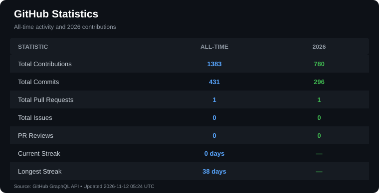

# Hi, I'm Hamza Naveed 👋

### Software Engineer | Flutter Developer | AI/ML Enthusiast

I'm a Computer Science student and software developer focused on building practical, scalable applications. I work primarily with **Flutter, C++, Python, and backend technologies**, with experience developing cross-platform mobile applications, REST APIs, real-time systems, and AI-powered features.

- 🔭 Working on mobile applications and AI-powered projects
- 🌱 Exploring Machine Learning, NLP, LLMs, and AI agents
- 💻 Interested in software engineering, mobile development, and applied AI
- 📫 Reach me through [GitHub](https://github.com/hamzanaxeed)

---

## 🛠️ Tech Stack

**Languages**

**Mobile & Backend Development**

**Databases & Cloud**

**AI, Data & Tools**

---

### 📊 GitHub Stats

  

### 💻 Most Used Languages

  

  <a href="https://github.com/hamzanaxeed?tab=overview">
    View my complete GitHub contribution activity
  </a>

---

## 🤝 Connect With Me

